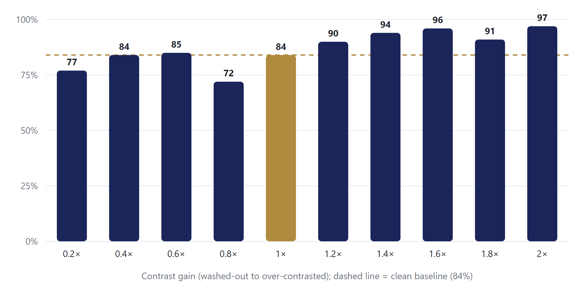
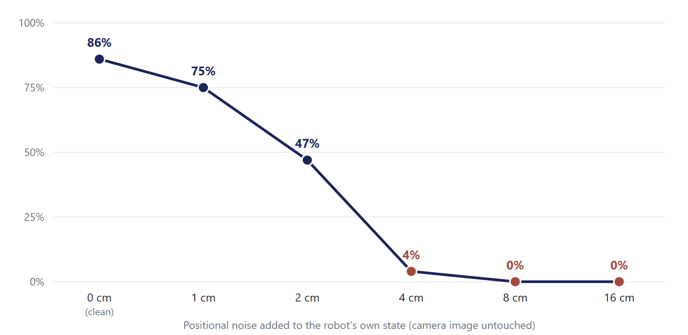
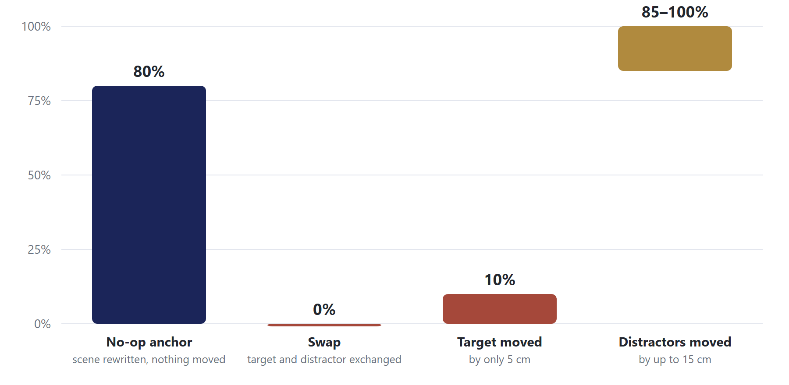

# VLA Failure Analysis

### Does π0 look at the object, or just remember where it usually is?

    

This repository is a **research project** and the **code behind it**. It studies whether the vision-language-action (VLA) model **π0** genuinely finds the object it is told to pick up, or whether it scores well on the standard LIBERO-Object benchmark by going to a *memorized place* with a *memorized motion*.

It contains (1) a pipeline that runs π0 in the LIBERO simulator and records everything, (2) tools that analyze where the model "looks", and (3) the full set of reports, data and evidence from the study.

> **Just want the results?** Read [`research/REPORT.md`](research/REPORT.md). It is an illustrated, plain-language report. The [research index](research/README.md) links everything else.

---

## Table of contents

1. [The result in one minute](#the-result-in-one-minute)
2. [Why this question matters](#why-this-question-matters)
3. [What was found](#what-was-found)
4. [How the study was organized](#how-the-study-was-organized)
5. [Repository map](#repository-map)
6. [What is and isn't in this code snapshot](#what-is-and-isnt-in-this-code-snapshot)
7. [Quick start: run the pipeline](#quick-start-run-the-pipeline)
8. [Configuration reference](#configuration-reference)
9. [What gets recorded](#what-gets-recorded)
10. [Analyzing attention](#analyzing-attention)
11. [Reproducing the headline numbers](#reproducing-the-headline-numbers)
12. [Documentation index](#documentation-index)
13. [Limitations](#limitations)
14. [Credits, citation and license](#credits-citation-and-license)

---

## The result in one minute

π0 scores **84–94%** on LIBERO-Object, which looks like real object understanding. Three independent experiments say the score is easier to earn than it looks:

| | Experiment | Result |
|---|---|---|
| **87 / 100** | Clean, unperturbed baseline | The anchor every other number is measured against |
| **86% → 4%** | Add about **4 cm** of noise to the robot's *own arm-state* signal, camera untouched | Success collapses |
| **80% → 0 / 20** | **Swap** the target with another object on the table | The robot grasps the decoy in **60%** of attempts and reaches the true target in only **15%** |

> **Conclusion.** π0 appears to succeed by **going to the right place with the right motion, not by finding the right object.** The benchmark also makes this shortcut easy: every task places objects on the same six spots, and the target always sits on one of only two of them. A high LIBERO-Object score is therefore weaker evidence of grounding than it looks.

This is evidence from one model on one benchmark. See [Limitations](#limitations).

## Why this question matters

When told *"pick up the orange juice and place it in the basket,"* a model that truly understands should (1) understand the target is the orange juice, (2) locate it in the camera images, and (3) drive the arm to *that* object.

A model might instead learn *"from this starting pose, execute this motion"*. That works whenever objects sit where they always do, and fails the moment something is moved. Robots deployed in homes, hospitals or warehouses will face moved objects constantly, so a high benchmark score that hides this shortcut is a real risk. The longer-term goal is to make VLA models **ground their actions in the instructed object**.

The study is organized around four candidate shortcut families: **position**, **state**, **language** and **trajectory**. The work reported here builds direct evidence for **position** and **state**; language shortcuts are untested.

## What was found

### 1. A silent bug nearly invalidated the project
The inherited pipeline scored **10/100** with no error message. The cause was a single wrong library version (`transformers 5.12.1`): the vision encoder **silently loaded random weights** instead of trained ones. Pinning `transformers==5.3.0` restored all 4.03 billion parameters and a 91/100 baseline; the clean baseline settled at **87/100**. *If you reproduce this work, that pin is the single most important thing to get right.* See [`requirements-working.txt`](requirements-working.txt) and [`docs/stage1_issues_and_reproduction.md`](docs/stage1_issues_and_reproduction.md).

### 2. Changing the picture does almost nothing
Brightness offsets from 0 to 100 kept success at **86–96%**. A tenfold range of contrast kept it at **72–97%**.



### 3. Corrupting the robot's sense of its own arm destroys it
Adding small, physically scaled noise to the robot's proprioceptive state (end-effector position, orientation, gripper) produced a cliff, with the camera never touched:



### 4. Where the model looks doesn't explain what it does
Attention heat maps (10 trials per object) showed the model's attention on a **background band** for alphabet soup, on a **nearby BBQ-sauce bottle** for orange juice (sharpest attention of any object, yet it still grasps the right bottle every time), and nowhere in particular for chocolate pudding. Under arm-state noise the attention stayed **identical** while behavior collapsed; under contrast changes attention swung about **tenfold** while behavior stayed unchanged. Success does not track attention in either direction. See [`docs/attention_baseline_findings.md`](docs/attention_baseline_findings.md) and the clips in [`report_videos/`](report_videos/).

### 5. Rearranging the table breaks it, and shows why
LIBERO-Object uses **six fixed object slots**, with at most 2 cm of positional randomization, and the target always occupies one of just **two** of them. Rewriting the scene directly:



Swapping target and distractor drops success from **80% to 0/20**; moving the target just **5 cm** drops it to **10%**; moving distractors up to 15 cm leaves success at **85–100%**, which shows the robot isn't just upset by any change, it cares where the target *used to be*. The 160 rollout clips are in [`research/evidence/stage3-videos/`](research/evidence/stage3-videos/).

**Where to dig deeper:** [`research/REPORT.md`](research/REPORT.md) (readable), the [technical report](research/reports/VLA-Failure-Analysis-Technical-Report.pdf) (full methods and limitations), and [`research/data/`](research/data/) (every number as CSV).

## How the study was organized

| Stage | Goal | Status |
|---|---|---|
| **0. Groundwork** | Literature review and a plan with the advisor and graduate mentor | Done |
| **1. Trusted baseline** | Reproduce π0 on LIBERO-Object, find and fix the silent bug, record attention | Done |
| **2. Perturb the senses** | Change brightness, contrast and robot state, one factor at a time | Done |
| **3. Perturb the world** | Swap and move objects in the simulated scene | Done (20 episodes per condition) |
| **4. Failure stages** | Classify when in the task each failure happens (approach, grasp, transport, placement) | Pending |

Two rules run through every experiment. **Attention is a hypothesis, perturbation is the evidence**: a heat map is only trusted once a controlled change turns it into proof. **One change at a time**: each sweep varies a single factor with the random seed held fixed, and includes a "no-op" condition that runs the whole pipeline while changing nothing, so harness bugs show up before real experiments run.

## Repository map

```text
.
├── README.MD                      You are here
├── research/                      The study: reports, data, evidence, weekly reports
│   ├── REPORT.md                    Illustrated plain-language report (start here)
│   ├── README.md                    Research index with a claim → evidence map
│   ├── reports/                     Technical report + plain-language summary (Word, PDF)
│   ├── data/                        Every reported number as CSV
│   ├── evidence/                    Original 10/100 run; 160 Stage 3 rollout clips
│   ├── figures/                     Charts (PNG, SVG)
│   ├── presentation/                Exit presentation and speaker notes
│   ├── progress-reports/            Weekly reports, May 14 – Aug 21, 2026
│   ├── spring-2026/                 Spring LIBERO-plus robustness study
│   └── literature.md                Papers this work builds on
│
├── configs/
│   ├── server/                      Policy-server configs (π0 LIBERO, UR5)
│   └── runner/libero_pi0.yaml       LIBERO client / experiment config
├── scripts/
│   ├── run_policy_server.py         Start the model server
│   ├── run_libero_eval.py           Run the LIBERO evaluation client
│   ├── analyze_attention.py         Attention metrics and heatmap videos from recorded episodes
│   └── diagnose_norm_stats.py       Normalization diagnostics
├── src/
│   ├── server/                      FastAPI server (/health, /predict) and adapters
│   ├── runner/                      LIBERO evaluator, observation builder, policy client
│   ├── models/pi0/                  π0 model wrapper
│   ├── common/ · utils/ · visualize/  Shared helpers, attention utilities, visualization
├── analysis/attention/              Attention analyzer: metrics, figures, configs
├── robots/                          Robot-arm and inference abstractions
├── notebook/                        Exploratory notebooks (π0, attention heatmaps, NLL, velocity)
├── test/                            Test and inspection scripts (model, predict API, LIBERO)
├── docs/                            Setup guides and the project's written findings (see index below)
├── report_videos/                   Attention clips from the clean baseline, plus contact sheets
├── vlas/                            Vendored LeRobot source and model-checkpoint tooling
├── requirements-working.txt         The verified, pinned environment (read this first)
├── summer_research_plan.md          The original research plan
├── progress.md                      Day-by-day baseline-reproduction log
└── CLAUDE.md                        Project brief for AI coding assistants
```

## What is and isn't in this code snapshot

**Included:** the full two-process pipeline (policy server and LIBERO client), recording of every trajectory, the attention extraction and analysis tools, and the perturbation knobs `observation.alpha` (contrast), `observation.beta` (brightness) and `observation.test_zero_proprio` (replace the robot state with a fixed pose).

**Not yet in this repository:** the later Stage 2 and Stage 3 tooling was developed on the lab's shared server and has not been added here. That is the physically scaled proprioception-noise option, the config-driven 100-episode sweep driver, the GPU watcher, and the **scene-perturbation system** (swap and move objects by rewriting the LIBERO initial state). **Their results and evidence are fully documented in [`research/`](research/)**: the numbers as CSV, the Stage 3 clips, and the methods in the technical report. The sweep logs (about 102 GB) also stay on the lab server.

## Quick start: run the pipeline

The system is two processes that talk over HTTP: a **policy server** that loads π0 and answers `/predict` requests, and a **LIBERO client** that steps the simulator and sends it images, the instruction and the robot state. They use **separate environments**. The lab ran them on two NVIDIA A40 GPUs (server on one, client on the other).

> **Read this first: the one pin that matters.** The vendored LeRobot pins `transformers==4.57.1`, which crashes π0's vision code, while `pyproject.toml` allows any `transformers>=5.3.0`, which resolves to a newer 5.x that **silently loads the vision encoder wrongly (about 10/100 success)**. Use `transformers==5.3.0`. Everything is spelled out in [`requirements-working.txt`](requirements-working.txt).

All commands assume the project root:

```bash
export VLA_FAILURE_ANALYSIS_ROOT="/path/to/VLA-Failure-Analysis"
cd "$VLA_FAILURE_ANALYSIS_ROOT"
```

### 1. Server environment (Python 3.12)

```bash
conda create -n lerobot python=3.12 && conda activate lerobot
pip install torch==2.7.1 torchvision==0.22.1 --index-url https://download.pytorch.org/whl/cu128
pip install -e "vlas/lerobot[pi]"
pip install transformers==5.3.0 tokenizers==0.22.1      # override to the working version
pip install fastapi "uvicorn[standard]" pyyaml matplotlib scikit-learn
export PYTHONPATH="$VLA_FAILURE_ANALYSIS_ROOT"
```

This is the minimal server install, following [`requirements-working.txt`](requirements-working.txt). [`docs/lerobot.md`](docs/lerobot.md) also lists extra packages (for example `tensorflow`, `robosuite`, `bddl`, `gym`) for the full analysis workflows; install those if you need them.

### 2. Download the checkpoint

```bash
cd vlas/checkpoints
python download_model.py lerobot/pi0_libero_finetuned_v044 --target_dir=.
cd "$VLA_FAILURE_ANALYSIS_ROOT"
```

This creates `vlas/checkpoints/pi0_libero_finetuned_v044`, which the server config points to.

### 3. Start the server

```bash
python scripts/run_policy_server.py --config configs/server/pi0_libero_finetuned_v044_server.yaml
curl http://127.0.0.1:8001/health        # verify, from another terminal
```

### 4. Client environment (Python 3.9.13) and LIBERO

```bash
conda create -n libero python=3.9.13 && conda activate libero
git clone https://github.com/Lifelong-Robot-Learning/LIBERO.git /path/to/LIBERO
cd /path/to/LIBERO
pip install -r requirements.txt
pip install torch==1.11.0+cu113 torchvision==0.12.0+cu113 torchaudio==0.11.0 --extra-index-url https://download.pytorch.org/whl/cu113
pip install -e .
```

### 5. Run an evaluation

```bash
cd "$VLA_FAILURE_ANALYSIS_ROOT"
conda activate libero
export PYTHONPATH="$VLA_FAILURE_ANALYSIS_ROOT"
python scripts/run_libero_eval.py --config configs/runner/libero_pi0.yaml
```

Full guides, including a UR5 server config, are in [`docs/lerobot.md`](docs/lerobot.md) and [`docs/libero.md`](docs/libero.md). The step-by-step log of problems met while building this environment (and how each was fixed) is [`docs/stage1_issues_and_reproduction.md`](docs/stage1_issues_and_reproduction.md).

## Configuration reference

The client is configured by [`configs/runner/libero_pi0.yaml`](configs/runner/libero_pi0.yaml). The settings you will touch most:

| Setting | Default | What it does |
|---|---|---|
| `env.task_suite` | `libero_object` | Which LIBERO suite to run |
| `env.num_trials_per_task` | `50` | Episodes per task (the study used 10 tasks × 10 trials = 100 per condition) |
| `env.max_steps` | `500` | Step cap per episode |
| `experiment.seed` | `1` | Random seed; keep it fixed across a sweep |
| `observation.beta` | `30` | Brightness offset. **Set to `0` for the clean 87/100 baseline** (30 is an inherited offset) |
| `observation.alpha` | `1` | Contrast gain (1.0 = unchanged) |
| `observation.test_zero_proprio` | `false` | Replace the robot state with a fixed pose |
| `policy_client.include_attentions` | `true` | Ask the server to return attention maps (does not change behavior: 94/100 vs 91/100) |
| `logging.save_episode_npz` / `save_rollout_video` | `true` / `true` | Record each trajectory / front-camera video (both are needed for videos) |

The server is configured by [`configs/server/`](configs/server/); by default it listens on `127.0.0.1:8001` in `float16` on CUDA.

## What gets recorded

Each run writes to `experiment.output_dir`:

```text
outputs/<run>/
├── episodes_npz/task_<id>_episode_<n>.npz     one compressed file per episode
├── rollouts/<time>--episode=<n>--success=<bool>--task=<task>.mp4
└── results.json                               success, task, episode, video and NPZ path per episode
```

Each NPZ holds the task description, initial state, success flag, actions (raw and processed), per-step **attention maps**, front and wrist images, and optional flow velocities, NLL values and hidden states.

## Analyzing attention

For each frame, the last layer's action-query attention is sliced into the **256 base-camera** and **256 wrist-camera** image-patch tokens and reshaped into a **16×16 heat map**. From it, four numbers are computed: **peak attention**, **entropy** (how spread out), **Gini coefficient** (how unequal), and **top-k patch share** (how much of the attention sits on the k strongest patches).

```bash
python scripts/analyze_attention.py \
    --npz_dir ./outputs/libero_eval_v044/episodes_npz \
    --output_dir ./outputs/libero_eval_v044/attention_analysis \
    --head_idx 0 --patch_grid_size 16 --top_k 5
```

This writes `sample_level_attention_metrics.csv` (all episodes), one per-episode metrics CSV, and front- and wrist-view **heat-map videos** under `heatmaps/`. To read the videos, see [`docs/how_to_read_attention_videos.md`](docs/how_to_read_attention_videos.md); example clips and contact sheets for four objects are in [`report_videos/`](report_videos/). Unreadable NPZ files, or ones without attention data, are skipped with a warning.

## Reproducing the headline numbers

| Number | How to get it |
|---|---|
| **10/100** (the bug) | Run with `transformers==5.12.1`. The original per-episode result is archived in [`research/evidence/stage1-broken-baseline/`](research/evidence/stage1-broken-baseline/) |
| **91/100** | Pin `transformers==5.3.0`, `torch==2.7.1`, keep `observation.beta: 30` |
| **94/100** | The same with `include_attentions: true` |
| **87/100 (clean anchor)** | The same with `observation.beta: 0` |

Run-to-run variation of the clean baseline was 84–87%, so differences of about 4 points are noise. All numbers and their sources are tabulated in [`research/data/`](research/data/).

## Documentation index

| Document | What it covers |
|---|---|
| [`research/REPORT.md`](research/REPORT.md) | The illustrated, plain-language report |
| [`research/README.md`](research/README.md) | Research index and evidence map |
| [`docs/lerobot.md`](docs/lerobot.md) | Model server setup and startup |
| [`docs/libero.md`](docs/libero.md) | LIBERO client setup, configuration and outputs |
| [`docs/stage1_issues_and_reproduction.md`](docs/stage1_issues_and_reproduction.md) | Plain-language log of every problem hit while reproducing the baseline, and the fixes |
| [`docs/attention_baseline_findings.md`](docs/attention_baseline_findings.md) | Baseline and per-object attention findings |
| [`docs/how_to_read_attention_videos.md`](docs/how_to_read_attention_videos.md) | A guide to the heat-map videos |
| [`docs/progress_baseline_and_brightness.md`](docs/progress_baseline_and_brightness.md) | Baseline and brightness-sweep progress report |
| [`docs/progress_report.md`](docs/progress_report.md) | Stages 1–2 progress report (July 14, 2026) |
| [`progress.md`](progress.md) | Day-by-day baseline reproduction log |
| [`summer_research_plan.md`](summer_research_plan.md) | The original research plan |

## Limitations

- **One model, one benchmark.** All results are for π0 on LIBERO-Object and do not show that other VLA models or benchmarks behave the same way.
- **Stage 3 is the newest and thinnest evidence.** It uses 20 episodes per condition (the earlier sweeps use 100), and the scene-perturbation scripts were written from scratch this summer and have not had an independent review.
- **Attention is a clue, not proof.** Attention has not yet been recorded during the swap condition, so it is not yet known whether the model's attention follows the target to its new position.
- **Run-to-run noise.** Clean baselines were 84%, 86% and 87%; each sweep used a single seed.
- **State is partly recoverable from the wrist camera**, so a small drop under state noise would not on its own prove the model ignores state.
- **Numbers in `research/data/` were transcribed from the weekly reports**, not regenerated from the raw per-run files, which stay on the lab server.
- **Documented quirks of the inherited client.** For example, `LiberoEvaluator.evaluate()` runs from task ID 8 to the end of the suite, and episode IDs in file names start at 400. See [`docs/libero.md`](docs/libero.md).

## Credits, citation and license

Work by **Ashzaeen Fatmi Khan** in the **Robotic Vision Laboratory, University of Texas at Arlington**, advised by **Dr. William Beksi**, with **Zongyao Lyu** as graduate mentor. The preliminary pipeline and experiments this work extends came from the lab. The model is **π0** from Physical Intelligence; the benchmark is **LIBERO**. Papers this work builds on are listed in [`research/literature.md`](research/literature.md).

If you use this work, please cite it as:

```text
Khan, A. F. (2026). Failure Analysis and Object Grounding in π0 on LIBERO-Object.
Robotic Vision Laboratory, University of Texas at Arlington.
https://github.com/ashzaeen/VLA-Failure-Analysis
```

**License:** this repository does not yet have a top-level license file. The vendored LeRobot source under `vlas/lerobot/` carries its own [`LICENSE`](vlas/lerobot/LICENSE).
