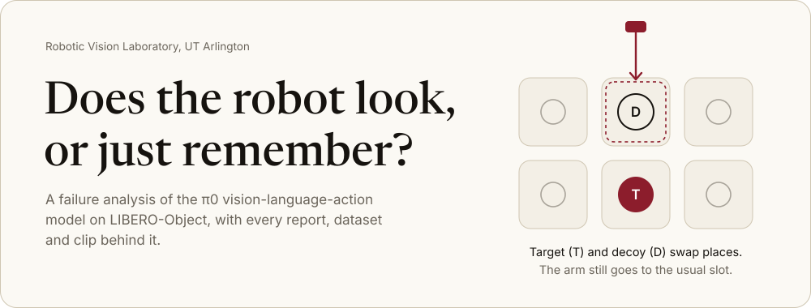
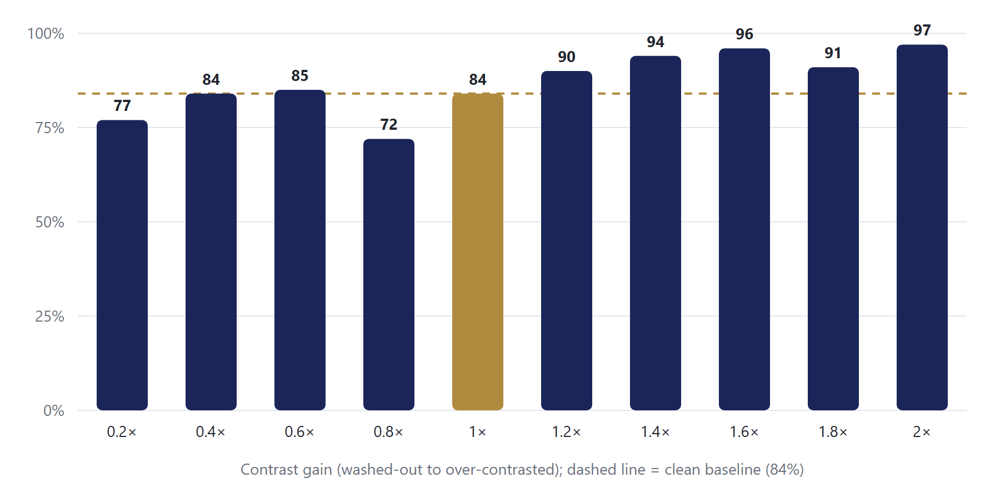
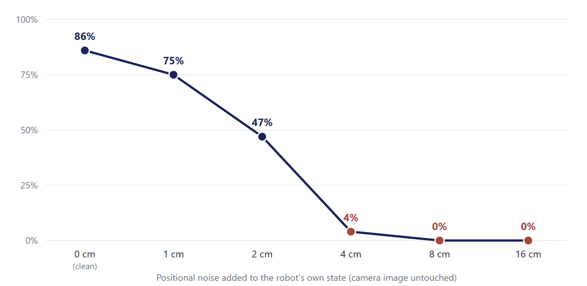
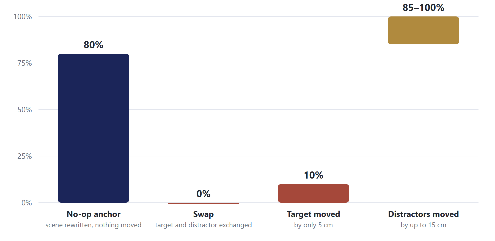

<p align="center">
  <picture>
    <source media="(prefers-color-scheme: dark)" srcset="docs/assets/readme/hero-dark.svg">
    
  </picture>
</p>

<p align="center">
  <a href="https://ashzaeen.github.io/VLA-Failure-Analysis/"><picture><source media="(prefers-color-scheme: dark)" srcset="docs/assets/readme/button-briefs-dark.svg"></picture></a>
  <a href="research/summer-failure-analysis/reports/Technical-Report.pdf"><picture><source media="(prefers-color-scheme: dark)" srcset="docs/assets/readme/button-report-dark.svg"></picture></a>
</p>
<p align="center">
  <a href="research/summer-failure-analysis/data/"><picture><source media="(prefers-color-scheme: dark)" srcset="docs/assets/readme/button-data-dark.svg"></picture></a>
  <a href="research/summer-failure-analysis/evidence/scene-perturbation-clips/"><picture><source media="(prefers-color-scheme: dark)" srcset="docs/assets/readme/button-clips-dark.svg"></picture></a>
</p>

<p align="center"><sub>π0 on LIBERO-Object &nbsp;·&nbsp; Python 3.12 &nbsp;·&nbsp; MIT license &nbsp;·&nbsp; Robotic Vision Laboratory, UT Arlington</sub></p>

**Does π0 look at the object, or just remember where it usually is?**

This repository is a study of the vision-language-action model **π0** on the LIBERO-Object benchmark, and everything behind it: a pipeline that runs π0 in the LIBERO simulator and records every episode, tools that show where the model looks, and the reports, data and video clips from two studies run in 2026.

**Contents:** [The short answer](#the-short-answer) · [What was found](#what-was-found) · [Two studies](#two-studies) · [Where to go](#where-to-go) · [Repository layout](#repository-layout) · [How the study was organized](#how-the-study-was-organized) · [Quick start](#quick-start) · [Limitations](#limitations) · [Credits and license](#credits-and-license)

---

## The short answer

π0 scores **84–94%** on LIBERO-Object, which looks like real object understanding. Three experiments suggest that score is easier to earn than it looks.

| | Experiment | Result |
|---|---|---|
| **87 / 100** | Clean, unperturbed baseline | The anchor every other number is measured against |
| **86% → 4%** | Add about **4 cm** of noise to the robot's *own arm-state* signal, camera untouched | Success collapses |
| **80% → 0 / 20** | **Swap** the target with another object on the table | The robot grasps the decoy in **60%** of attempts and reaches the true target in only **15%** |

> **Conclusion.** π0 appears to succeed by **going to the right place with the right motion, not by finding the right object.** The benchmark makes this shortcut easy: every task places objects on the same six spots, and the target always sits on one of only two of them. A high LIBERO-Object score is weaker evidence of grounding than it looks.

This is evidence from one model on one benchmark. See [Limitations](#limitations).

## What was found

**1. A silent bug nearly invalidated the project.** The inherited pipeline scored **10/100** with no error. A wrong library version (`transformers 5.12.1`) made the vision encoder **silently load random weights**. Pinning `transformers==5.3.0` restored a 91/100 baseline; the clean baseline settled at **87/100**. *If you reproduce this work, that pin is the most important thing to get right.* See [`requirements-working.txt`](requirements-working.txt) and the [reproduction log](docs/project-log/2026-06-25-Stage-1-Reproduction-Log.md).

**2. Changing the picture does almost nothing.** Brightness offsets from 0 to 100 kept success at **86–96%**; a tenfold range of contrast kept it at **72–97%**.



**3. Corrupting the robot's sense of its own arm destroys it.** Small, physically scaled noise on the robot's proprioceptive state, with the camera never touched, produced a cliff:



**4. Where the model looks doesn't explain what it does.** Attention heat maps showed the model looking at a background band (alphabet soup) or at a *nearby bottle* (orange juice) while still succeeding. Under arm-state noise attention stayed identical while behavior collapsed; under contrast changes attention swung about tenfold while behavior stayed unchanged. See the [attention findings](docs/project-log/2026-07-03-Baseline-and-Attention-Findings.md) and [clips](research/summer-failure-analysis/evidence/attention-audit/).

**5. Rearranging the table breaks it, and shows why.** LIBERO-Object uses **six fixed object slots**, and the target always occupies one of just **two**. Rewriting the scene directly:



Swapping the target with another object drops success from **80% to 0/20**; moving the target just **5 cm** drops it to **10%**; moving *other* objects up to 15 cm leaves it at **85–100%**. The robot isn't upset by any change, it cares where the target *used to be*. The 160 clips are in [`research/summer-failure-analysis/evidence/scene-perturbation-clips/`](research/summer-failure-analysis/evidence/scene-perturbation-clips/).

## Two studies

The work ran in two parts. The spring study found where π0 is brittle, and the summer study tested why.

| | Question | Read | Files |
|---|---|---|---|
| **Spring 2026** | How does π0 degrade when the instruction, scene, camera or robot start changes? | [Interactive brief](https://ashzaeen.github.io/VLA-Failure-Analysis/Spring-2026-VLA-Robustness-LIBERO-Plus.html) | [`research/spring-robustness-study/`](research/spring-robustness-study/README.md) |
| **Summer 2026** | Does π0 find the instructed object, or go to a memorized place? | [Interactive brief](https://ashzaeen.github.io/VLA-Failure-Analysis/Summer-2026-VLA-Failure-Analysis.html) | [`research/summer-failure-analysis/`](research/summer-failure-analysis/README.md) |

## Where to go

| I want to… | Go to |
|---|---|
| Read the results in plain language | [`Illustrated-Report.md`](research/summer-failure-analysis/reports/Illustrated-Report.md) |
| Read the full technical report | [`Technical-Report.pdf`](research/summer-failure-analysis/reports/Technical-Report.pdf) |
| See the raw numbers | [`research/summer-failure-analysis/data/`](research/summer-failure-analysis/data/) |
| Watch the experiments | [`research/summer-failure-analysis/evidence/`](research/summer-failure-analysis/evidence/README.md) |
| Follow the story week by week | [`research/summer-failure-analysis/progress-reports/`](research/summer-failure-analysis/progress-reports/README.md) |
| Run the pipeline myself | [Quick start](#quick-start), then [`docs/setup/`](docs/setup/) |
| Run the sweeps and scene experiments | [`docs/guides/Sweeps-and-Scene-Tooling.md`](docs/guides/Sweeps-and-Scene-Tooling.md) |
| Find any other document | [`docs/README.md`](docs/README.md) |

## Repository layout

```text
.
├── README.md · LICENSE · CLAUDE.md · requirements-working.txt
│
├── site/                  The two research briefs, published with GitHub Pages
├── research/              The two studies, each self-contained
│   ├── Literature.md        Papers the work builds on
│   ├── spring-robustness-study/    Spring 2026: π0 on LIBERO-plus (proposal, abstract, poster, code)
│   └── summer-failure-analysis/    Summer 2026: does π0 look, or remember?
│       ├── reports/           Illustrated report, technical report, plain-language summary
│       ├── data/              Every reported number as CSV
│       ├── evidence/          Original 10/100 run, scene-perturbation clips, attention audit
│       ├── figures/           Charts (PNG, SVG)
│       ├── presentation/      Exit presentation and speaker notes
│       └── progress-reports/  Weekly reports, May 14 – Aug 21, 2026
│
├── docs/                  Documentation
│   ├── setup/               Server and client installation
│   ├── guides/              How-to guides (sweeps, scene experiments, configuration, videos)
│   ├── project-log/         The working record, dated: reproduction logs, findings, plan
│   └── assets/readme/       Hero and button images used by this README
│
├── configs/               YAML configs (policy server, LIBERO runner)
├── scripts/               Entry points: server, evaluation, sweeps, attention analysis
├── src/                   Library code: server, runner, models, utilities
├── analysis/              Attention analysis library
├── robots/                Robot-arm and inference abstractions for LIBERO
├── examples/ · notebooks/ · tests/
├── tools/lab-server/      Run scripts used on the lab's GPU server (see its README)
└── vlas/                  Vendored third-party model code (LeRobot, OpenVLA-OFT)
```

## How the study was organized

| Stage | Goal | Status |
|---|---|---|
| **0. Groundwork** | Literature review and a plan agreed with the advisor and graduate mentor | Done |
| **1. Trusted baseline** | Reproduce π0 on LIBERO-Object, find and fix the silent bug, record attention | Done |
| **2. Perturb the senses** | Change brightness, contrast and robot state, one factor at a time | Done |
| **3. Perturb the world** | Swap and move objects in the simulated scene | Done (20 episodes per condition) |
| **4. Failure stages** | Classify *when* in the task each failure happens | Pending |

Two rules run through every experiment. **Attention is a hypothesis, perturbation is the evidence**: a heat map is only trusted once a controlled change turns it into proof. **One change at a time**: each sweep varies a single factor with the seed fixed, and includes a "no-op" condition that runs the whole pipeline while changing nothing, so harness bugs show up first.

## Quick start

The system is two processes that talk over HTTP: a **policy server** that loads π0 and answers `/predict`, and a **LIBERO client** that steps the simulator. They use **separate environments**. The lab ran them on two NVIDIA A40 GPUs.

> **The one pin that matters.** The vendored LeRobot pins `transformers==4.57.1`, which crashes π0's vision code, while its `pyproject.toml` allows any `transformers>=5.3.0`, which resolves to a newer 5.x that **silently loads the vision encoder wrongly (about 10/100 success)**. Use `transformers==5.3.0`. Details in [`requirements-working.txt`](requirements-working.txt).

```bash
export VLA_FAILURE_ANALYSIS_ROOT="/path/to/VLA-Failure-Analysis" && cd "$VLA_FAILURE_ANALYSIS_ROOT"
```

**1. Server environment (Python 3.12)**

```bash
conda create -n lerobot python=3.12 && conda activate lerobot
pip install torch==2.7.1 torchvision==0.22.1 --index-url https://download.pytorch.org/whl/cu128
pip install -e "vlas/lerobot[pi]"
pip install transformers==5.3.0 tokenizers==0.22.1      # override to the working version
pip install fastapi "uvicorn[standard]" pyyaml matplotlib scikit-learn
export PYTHONPATH="$VLA_FAILURE_ANALYSIS_ROOT"
```

**2. Download the checkpoint, then start the server**

```bash
(cd vlas/checkpoints && python download_model.py lerobot/pi0_libero_finetuned_v044 --target_dir=.)
python scripts/run_policy_server.py --config configs/server/pi0_libero_finetuned_v044.yaml
curl http://127.0.0.1:8001/health        # verify, from another terminal
```

**3. Client environment (Python 3.9.13) and LIBERO**

```bash
conda create -n libero python=3.9.13 && conda activate libero
git clone https://github.com/Lifelong-Robot-Learning/LIBERO.git /path/to/LIBERO && cd /path/to/LIBERO
pip install -r requirements.txt
pip install torch==1.11.0+cu113 torchvision==0.12.0+cu113 torchaudio==0.11.0 --extra-index-url https://download.pytorch.org/whl/cu113
pip install -e .
```

**4. Run an evaluation**

```bash
cd "$VLA_FAILURE_ANALYSIS_ROOT" && conda activate libero && export PYTHONPATH="$VLA_FAILURE_ANALYSIS_ROOT"
python scripts/run_libero_eval.py --config configs/runner/libero_pi0.yaml
```

Full guides, including a UR5 server config: [`docs/setup/Server-Setup.md`](docs/setup/Server-Setup.md) and [`docs/setup/Client-Setup.md`](docs/setup/Client-Setup.md).

## Going further

| Topic | Guide |
|---|---|
| Every setting, the files a run writes, the attention metrics, and how to reproduce 10 → 91 → 94 → 87 | [`docs/guides/Configuration-and-Outputs.md`](docs/guides/Configuration-and-Outputs.md) |
| Single-factor sweeps, proprioception noise, and the scene-perturbation system | [`docs/guides/Sweeps-and-Scene-Tooling.md`](docs/guides/Sweeps-and-Scene-Tooling.md) |
| Why and how the object-position experiments work (the six-slot finding) | [`docs/guides/Object-Position-Experiments.md`](docs/guides/Object-Position-Experiments.md) |
| Reading the attention heat-map videos | [`docs/guides/Reading-Attention-Videos.md`](docs/guides/Reading-Attention-Videos.md) |
| The scripts used on the lab server (sweep launchers, GPU watcher) | [`tools/lab-server/README.md`](tools/lab-server/README.md) |
| Everything else, indexed | [`docs/README.md`](docs/README.md) |

The sweep and scene tooling was developed on the lab's shared server and added here afterwards. It has been checked to compile, but running it needs a GPU, the model server and LIBERO. The sweep logs (about 102 GB) stay on the lab server, so the **results and evidence** are in [`research/`](research/summer-failure-analysis/README.md).

## Limitations

- **One model, one benchmark.** All results are for π0 on LIBERO-Object and do not show that other VLA models or benchmarks behave the same way.
- **Stage 3 is the newest and thinnest evidence.** It uses 20 episodes per condition (the earlier sweeps use 100), and its scripts were written from scratch this summer without an independent review. The tooling here has only been checked to compile.
- **Attention is a clue, not proof.** It has not yet been recorded during the swap condition, so it is not known whether attention follows the target to its new position.
- **Run-to-run noise.** Clean baselines were 84%, 86% and 87%, and each sweep used a single seed.
- **State is partly recoverable from the wrist camera**, so a small drop under state noise would not alone prove the model ignores state.
- **The tables in `research/summer-failure-analysis/data/` were transcribed from the weekly reports**, not regenerated from raw per-run files, which stay on the lab server.
- **Inherited-code quirks** are documented in [`docs/setup/Client-Setup.md`](docs/setup/Client-Setup.md); for example, `LiberoEvaluator.evaluate()` runs from task ID 8 to the end of the suite.

## Credits and license

Work by **Ashzaeen Fatmi Khan** in the **Robotic Vision Laboratory, University of Texas at Arlington**, advised by **Dr. William Beksi**, with **Zongyao Lyu** as graduate mentor. The preliminary pipeline and experiments this work extends came from the lab. The model is **π0** from Physical Intelligence; the benchmark is **LIBERO**. Papers this work builds on are in [`research/Literature.md`](research/Literature.md).

**License.** Original work in this repository is released under the [MIT License](LICENSE). Third-party code vendored under [`vlas/`](vlas/) keeps its own license: LeRobot is Apache 2.0 ([`vlas/lerobot/LICENSE`](vlas/lerobot/LICENSE)), and the OpenVLA-OFT files are copied from [moojink/openvla-oft](https://github.com/moojink/openvla-oft) and remain under that project's terms.

**Citation.**

```text
Khan, A. F. (2026). Failure Analysis and Object Grounding in π0 on LIBERO-Object.
Robotic Vision Laboratory, University of Texas at Arlington.
https://github.com/ashzaeen/VLA-Failure-Analysis
```
