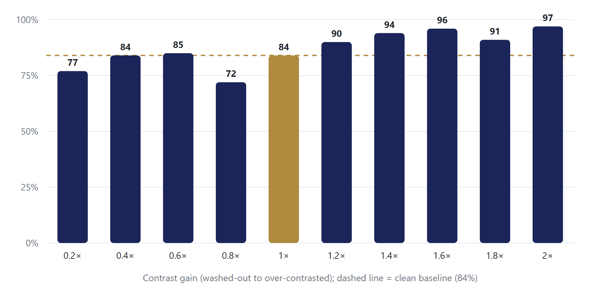
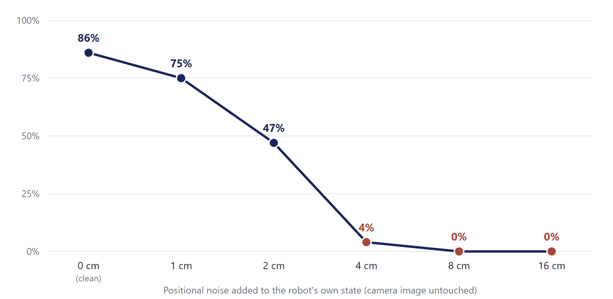
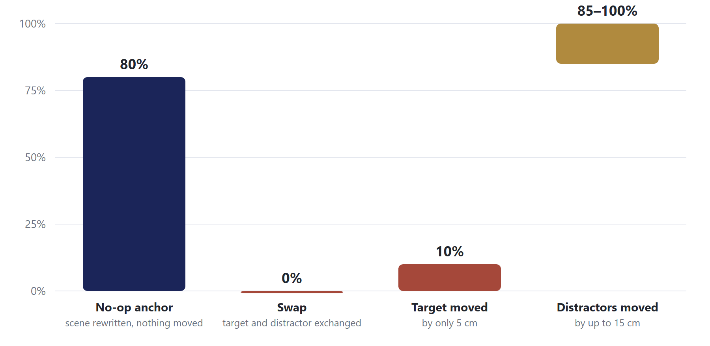

# Does π0 Look, or Just Remember?

**A plain-language report on failure analysis and object grounding in the π0 robot model**

*Ashzaeen Fatmi Khan · Robotic Vision Laboratory, UT Arlington · Advisor: Dr. William Beksi · Graduate mentor: Dr. Zongyao Lyu · Spring – Summer 2026*

> [!NOTE]
> This is the readable version. For the full methods, every table and the limitations, see the [technical report](Technical-Report.pdf). For a shorter, jargon-free version, see the [plain-language summary](Plain-Language-Summary.pdf).

---

## The Short Version

π0 is a **vision-language-action (VLA) model**: you give it camera images and a sentence like *"pick up the orange juice and put it in the basket"* and it moves a robot arm. On the standard test used here, **LIBERO-Object**, it succeeds **84–94%** of the time, which looks like real object understanding.

This project asked whether that score is *earned*. When π0 succeeds, is it **finding the instructed object**, or is it **going to the right place with the right motion**?

> [!IMPORTANT]
> Three independent experiments point the same way: **π0 appears to succeed by going to the right place with the right motion, not by finding the right object.** The test it is graded on also makes this shortcut easy, so a high LIBERO-Object score is weaker proof of understanding than it looks.

| | |
|---|---|
| **87 / 100** | the clean, unperturbed baseline everything is measured against |
| **86% → 4%** | success after about **4 cm** of noise on the robot's *own arm state*, with the camera untouched |
| **80% → 0 / 20** | success when the target and one other object simply **swap places** |

---

## The Question, With an Analogy

Picture someone who walks to the same shelf every day to grab a mug. If you move the mug to another shelf, a person who truly *looks* finds it. A person who learned a *routine* reaches for the empty spot.

On a day when the mug never moves, the two look identical. A robot test where objects almost never move cannot tell them apart. This project is about **moving the mug**.

## How the Study Worked

| Stage | What was done | Status |
|---|---|---|
| **0. Groundwork** | Literature review (π0, LIBERO-PRO, LIBERO-X) and a plan agreed with the graduate mentor | Done |
| **1. Trusted baseline** | Reproduce π0 on LIBERO-Object and record where it "looks" | Done |
| **2. Perturb the senses** | Change brightness, contrast and the robot's own state, one factor at a time | Done |
| **3. Perturb the world** | Swap and move objects in the simulated scene | Done (20 episodes per condition) |
| **4. Failure stages** | Classify when in the task each failure happens | Pending |

Two rules ran through everything. **Attention is a clue, not proof**: a heat map of where the AI looks is only trusted once a perturbation turns it into evidence. And **one change at a time**: every experiment varies a single factor with the random seed held fixed, and includes a "no-op" condition that runs the whole pipeline while changing nothing, so bugs show up early.

---

## What Was Found

### 1. A Hidden Bug Nearly Spoiled Everything

The first run of the lab's pipeline scored **10 / 100**. Nothing in the logs said why. The cause was a single wrong software version (`transformers 5.12.1`): part of the model's vision system **silently loaded random numbers instead of its trained weights**, so the robot was effectively reaching from memory. Pinning `transformers 5.3.0` fixed it and the score recovered to **91 / 100**. The clean baseline settled at **87 / 100**.

*Evidence: [`data/baselines.csv`](../data/baselines.csv), the original broken run in [`evidence/broken-baseline/`](../evidence/broken-baseline/), and [`docs/project-log/2026-06-25-Stage-1-Reproduction-Log.md`](../../../docs/project-log/2026-06-25-Stage-1-Reproduction-Log.md).*

### 2. Messing With the Picture Barely Matters

Brightness offsets from 0 to 100 kept success at **86–96%**. A tenfold range of contrast, from washed-out to over-contrasted, kept it at **72–97%**. Two different ways of badly degrading the image did essentially nothing.

*Evidence: [`data/contrast-sweep.csv`](../data/contrast-sweep.csv), [`data/brightness-sweep-summary.csv`](../data/brightness-sweep-summary.csv).*

### 3. Messing With the Robot's Sense of Its Own Arm Destroys It

Robots also track where their own arm is (**proprioception**). Adding a little noise to that signal, scaled to real distances, produced a cliff:

At about 1 cm of noise success held up; at 2 cm it fell under half; at 4 cm it was **4%**; from 8 cm it was **0%**. The camera was never touched. If the model were watching the object, a few centimetres of arm error would be corrected by what it sees. Instead it follows a **memorized motion tied to its own arm position**.

*Evidence: [`data/proprioception-noise-sweep.csv`](../data/proprioception-noise-sweep.csv).*

### 4. Where the Model "Looks" Does Not Explain What It Does

Heat maps of the model's attention told a surprising story, object by object (10 trials each):

| Object | Where the attention landed | Result |
|---|---|---|
| Alphabet soup | The far background, in all 10 trials | Succeeds 10/10 |
| Orange juice | Sharp and confident, but on a **nearby BBQ sauce bottle**, in all 10 trials | Succeeds 10/10 |
| Chocolate pudding | Diffuse; almost nothing on the wrist camera | Succeeds about 8/10 |
| Milk | Split between two hotspots in the failures | Fails 2/10 |

It also worked in both directions. Under arm-state noise the attention pattern stayed **identical** while behavior collapsed. Under contrast changes the attention swung about **tenfold** while behavior stayed **unchanged**. Task success does not track attention either way.

*Evidence: [`data/attention-audit.csv`](../data/attention-audit.csv), the contact sheets and clips in [`evidence/attention-audit/`](../evidence/attention-audit/), and [`docs/guides/Reading-Attention-Videos.md`](../../../docs/guides/Reading-Attention-Videos.md).*

### 5. Rearranging the Table Breaks It, and Shows Why

Before moving anything, the object positions in LIBERO-Object were decoded. They turned out to be **very repetitive**: every task uses the **same six spots**, positions vary by at most 2 cm, and the target always sits on **one of only two** of those spots. A robot that never looked at anything but learned to reach for one of two places could still score well.

So the scene itself was rearranged:

- **Swap** the target with another object: success falls from **80% to 0 out of 20**. In **60%** of attempts the robot grasped the *decoy* sitting in the target's usual spot, and it reached the true target only **15%** of the time.
- **Move the target** by just 5 cm: success falls to **10%**. A cliff, not a slope.
- **Move the other objects** up to 15 cm: success stays at **85–100%**. This control matters. It shows the robot is not simply upset by any change; it specifically cares where the target *used to be*.

*Evidence: [`data/scene-perturbations.csv`](../data/scene-perturbations.csv) and 160 rollout videos in [`evidence/scene-perturbation-clips/`](../evidence/scene-perturbation-clips/).*

---

## What It Means

1. **π0 may be succeeding largely by going to the right place with the right motion**, not by looking at the right object.
2. **This is a limit of the test as well as the model.** A fixed six-spot grid with two target spots rewards a robot that never looks.
3. **High LIBERO-Object scores are weak evidence of understanding**, including this project's own 87–94% baselines.

This also fits the spring result, [presented at the CRA Undergraduate Conference](../../spring-robustness-study/): the model coped with moved *objects* but struggled when the *robot or camera* was moved, which is exactly what an arm-anchored policy would do.

## What This Does *Not* Show

- It is **one model on one benchmark**. Other robots may behave differently.
- The Stage 3 results use **20 attempts per condition**, and the scene-moving scripts were written from scratch this summer. They need independent review before being treated as final.
- An attention heat map is a **clue, not proof**. Attention has not yet been recorded during the swap itself.
- Repeat runs of the clean baseline gave **84%, 86% and 87%**, so differences of about 4 points are noise.

## What Comes Next

1. Record attention **during the swap**: does the model's gaze follow the object while its arm goes to the old spot?
2. Classify **when** failures happen: reaching, grasping, carrying or placing.
3. Add a frozen-arm-state control, and test whether the **wording** of the instruction matters.
4. Evaluate on tests where objects really do **move around**, which is what a real home looks like.

---

## Where Everything Is

See the [research index](../README.md) for the full map. In brief:

| I want to… | Go to |
|---|---|
| Read the full technical write-up | [`reports/`](./) |
| See the raw numbers | [`data/`](../data/) |
| Watch the experiments | [`evidence/scene-perturbation-clips/`](../evidence/scene-perturbation-clips/) and [`evidence/attention-audit/`](../evidence/attention-audit/) |
| Follow the week-by-week story | [`progress-reports/`](../progress-reports/) |
| See the final presentation | [`presentation/`](../presentation/) |
| Reproduce the pipeline | the repository [README](../../../README.md) and [`../docs/`](../../../docs/) |
